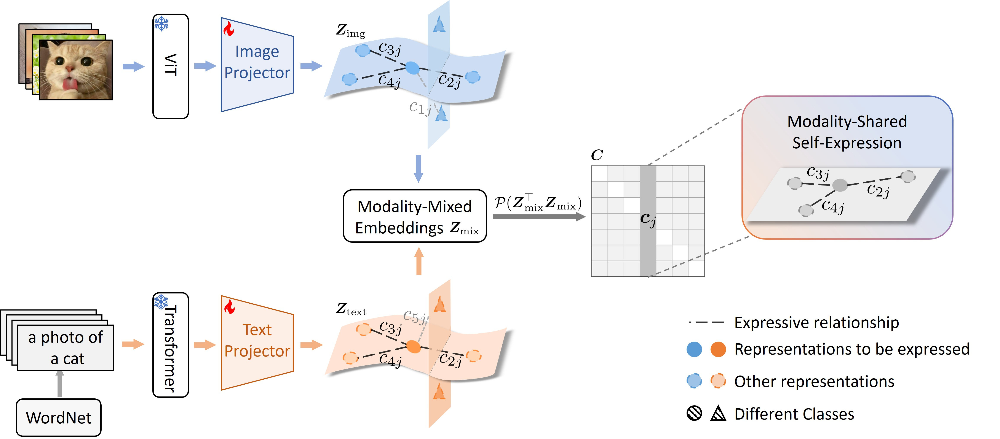

# About DeepMORSE

Deep <u>mo</u>dality-sha<u>r</u>ed <u>s</u>elf-<u>e</u>xpressive model (DeepMORSE) is a simple but principled approach for image clustering assisted with textual information. It discovers cross-modal structures via a modality-shared self-expressive model and simultaneously learns structured representations that conform to a union of modality-specific subspaces.

# How to Run DeepMORSE?

**Step 1:** Download the extracted CLIP image and text features from [here](https://drive.google.com/drive/folders/1_qqetrZHSEjAsM8Xp7fQUUgdjLVExRnl?usp=drive_link) and put them under `./data/datasets`.

**Step 2:** Train DeepMORSE by running:

```bash
python main.py --data CIFAR-10 --n_clusters 10 --epo 50
python main.py --data CIFAR-20 --n_clusters 20 --epo 50
python main.py --data ImageNet-Dogs --n_clusters 15 --epo 50
python main.py --data DTD --n_clusters 47 --epo 100
python main.py --data UCF101 --n_clusters 101 --epo 100
python main.py --data ImageNet --n_clusters 1000 --epo 500 --hidden_dim 8192 --z_dim 1024 --bs 8192 --gamma 600
```


